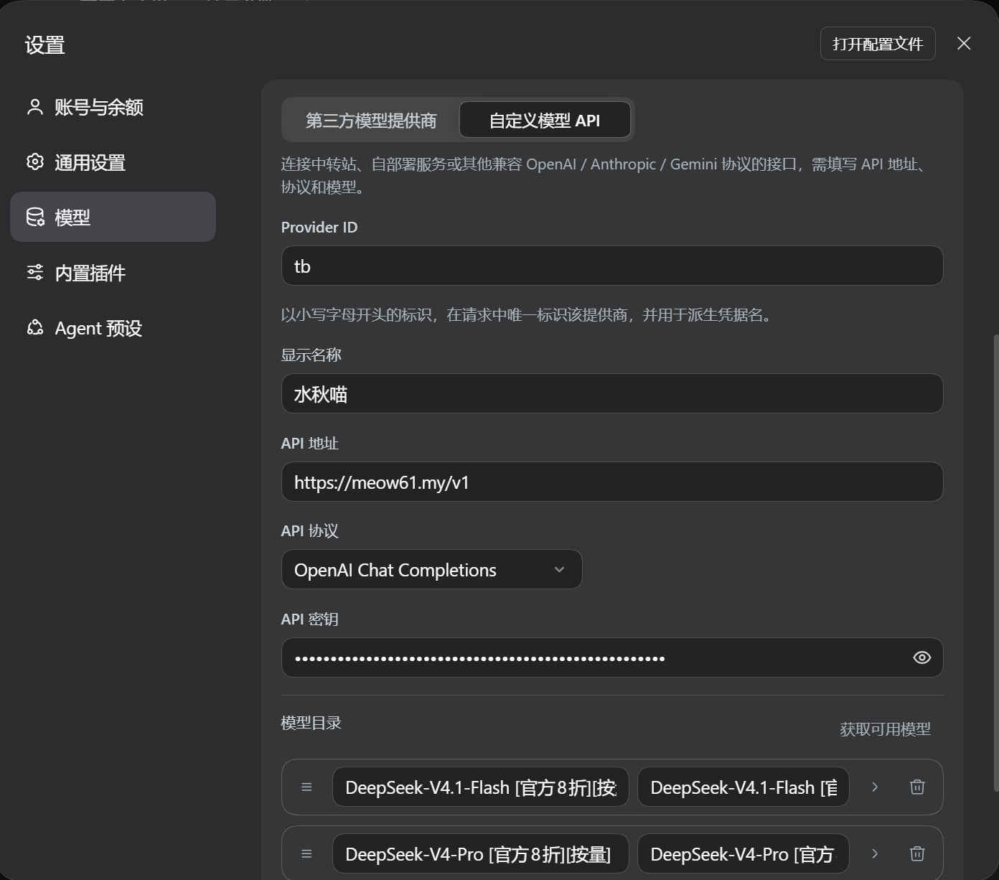

# DeepSeek Harness 接入教程

通过 **自定义模型 API** 添加水秋喵，获取模型后即可选择使用。

## 1. 准备工作

- 已安装并打开 DeepSeek Harness。
- 准备 API 密钥（可在[水秋喵的小店](https://shop319152708.taobao.com/)购买，详见[购买与套餐](/buy)）。

## 2. 添加自定义模型 API

1. 打开 **设置** → **模型**。
2. 切换到 **自定义模型 API**，填写以下信息：

| 配置项 | 填写内容 |
| --- | --- |
| Provider ID | `tb`（以小写字母开头，同一提供商使用唯一标识） |
| 显示名称 | `水秋喵` |
| API 地址 | `https://meow61.my/v1`（与下图一致） |
| API 协议 | **OpenAI Chat Completions** |
| API 密钥 | 粘贴购买后收到的密钥 |

::: tip API 地址
截图使用 `https://meow61.my/v1`；也可使用本站教程的主地址 `https://api.meow61.my/v1`。地址保留结尾的 `/v1`。
:::

## 3. 获取并选择模型

1. 填好地址、协议和密钥后，点击 **模型目录** 右侧的 **获取可用模型**。
2. 确认模型目录中出现要使用的模型，例如：
   - `DeepSeek-V4.1-Flash [官方8折][按量]`
   - `DeepSeek-V4-Pro [官方8折][按量]`
3. 回到使用界面，在模型选择处选择刚添加的模型，发送一条消息测试。

完整型号与计费见[模型列表](./models)。手动填写模型 ID 时，完整复制列表中的名称，包括空格和方括号。

## 4. 常见问题

### 获取可用模型失败或列表为空？

- 检查 API 地址是否包含 `/v1`，密钥是否完整、是否带有多余空格。
- 确认 API 协议选择 **OpenAI Chat Completions**。
- 尝试切换到 `https://api.meow61.my/v1`，再点击 **获取可用模型**。
- 通过[密钥查询](https://check.meow61.my)检查剩余额度，通过[API 状态查询](https://status.meow61.my/status/api)查看服务状态。

### 提示模型不存在？

重新获取可用模型，并选择返回的完整模型 ID；手动添加时可对照[模型列表](./models)复制名称。
